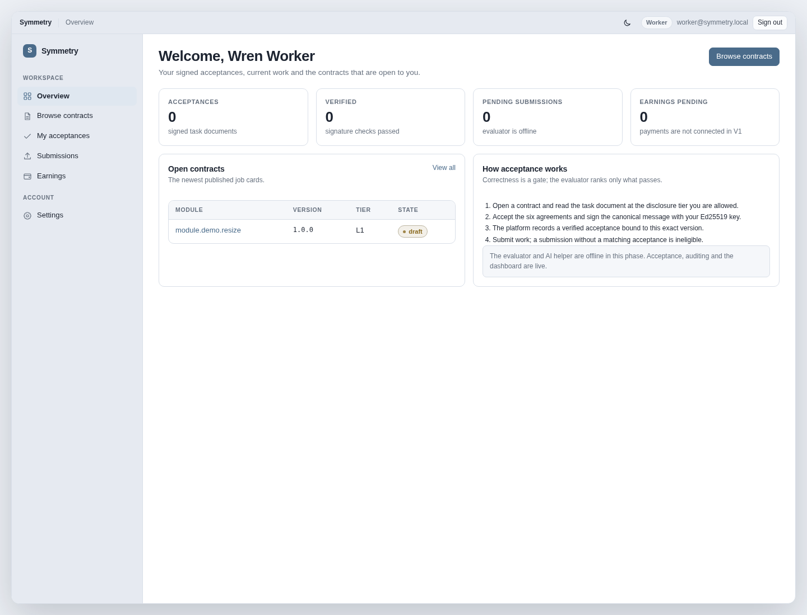
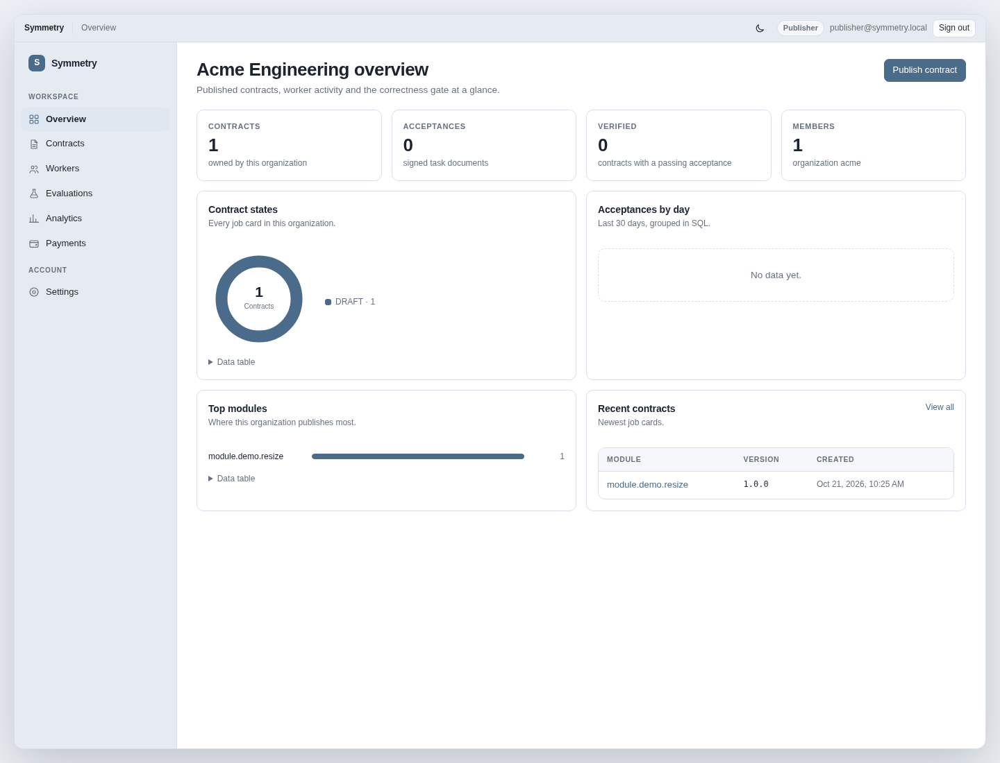
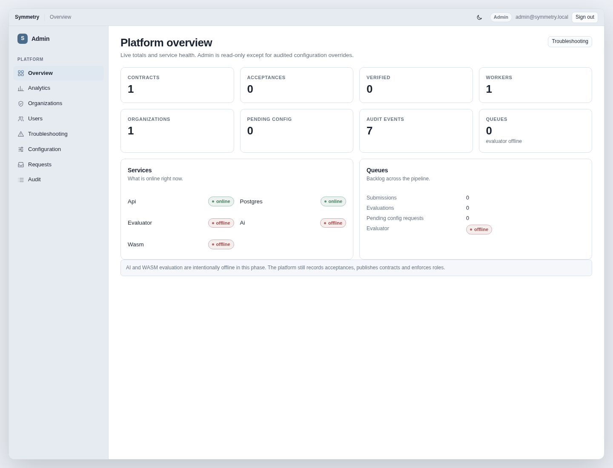

# Symmetry: Future of software tech work

**One-line idea:** a company shows the *outside* of a missing piece of its software.
Outside helpers build the *inside*. The piece that is correct **and** fastest wins
the job and gets paid.

---

## The big idea, in plain words

Imagine a car factory. A car is made of many parts. We call each part a **module**.
One module is missing. The factory does *not* hand strangers the secret blueprint
for its engine. Instead it hands them a **job card** that says:

> "Make a part that fits here. It takes these inputs, gives back this output. It
> must finish in under X milliseconds. It must not touch the internet."

A **worker** (an outside helper, like a freelancer) reads the job card, agrees to
its rules, and builds the part using the language the factory's **task committee**
says its existing software uses — it could be Java, C, Go, Python, TypeScript, or
several at once. They send back the source code.

The factory keeps a **secret answer key** (hidden tests). The worker's part is
built and checked privately. If it passes, we then compare it with other passing
parts by how **fast** it is and how **light on memory** it is. The winner is paid,
and their part is snapped into the car.

That is the whole system — for the **first kind of work**, which we call
**`optimize`** (make an existing part better).

---

## Screenshots — build 0.0.1

Real captures from the running app at 1440×1100 in the light Harbor theme.

### Worker main page

### Publisher organization main page

### Admin main page

A PostgreSQL development snapshot and restore steps are in
[`data/pgsql/0.0.1/`](data/pgsql/0.0.1/).

---

## The second kind of work: building something brand new

Sometimes there is *no* existing part. The company has a **completely new idea**
and no old code to compare against. This is the **`build`** track, and it works
differently:

- Workers (experienced, vetted ones) first submit a **proposal**: a **design**, an
  **implementation plan**, and a **rate of pay** (hourly and/or a fixed price).
- The company reviews the proposals with a scorecard and picks one.
- The work is done in **milestones**; money is released as each milestone passes,
  so pay is tied to real progress, not to padded hours.

The full details are in [docs/NEW-BUILDS.md](docs/NEW-BUILDS.md).

---

## The one big catch

To make this work, we must check the part is correct **without showing the secret
answer key** and **without leaking the factory's secrets**. Keeping a secret while
also checking the truth is hard. The entire design is built to solve this tension.
We call the two halves:

- **Verifiability** — we *can* prove a part is correct.
- **Without leakage** — we do *not* reveal the factory's secrets or hidden data.

---

## The most important rule

**Correctness is a gate.** A part must pass every correctness test *first*. Only
then do we compare speed and memory. A super-fast part that is wrong never wins.

---

## Words we use a lot (mini-glossary)

- **Module** — one part of a software system; a piece that does one job.
- **Contract** — the machine-readable job card (name, inputs, outputs, limits).
- **Task document** — the plain-language instructions a worker must agree to.
- **Worker** — an outside person who builds a module.
- **Submission** — the source code a worker sends in.
- **Oracle** — the hidden answer key; how we decide if code is correct.
- **Gate** — the checkpoint a submission must pass before it can be compared.
- **Sandbox** — a safe box where untrusted code runs so it cannot cause harm.
- **Pareto frontier** — the "still in the race" list; you only drop off if some
  other part beats you on *everything* (more in `docs/DESIGN.md`).

---

## What is already decided

- **Target:** proprietary (closed, company-owned) software.
- **Two kinds of work:** `optimize` an existing module, or `build` a brand-new app.
- **Worker language:** any language the task committee's existing software uses
  (for `optimize`), or the language the worker proposes (for `build`). Not limited
  to Java and Rust.
- **How we judge:** correctness first, then speed and memory (for `optimize`); a
  quality rubric and milestone reviews (for `build`).
- **Built with:** a **Java Spring Boot API**, **Rust→WASM** modules, a **Python AI**
  service, **PostgreSQL**, and a **React** UI with a custom macOS-style design. See
  [docs/STACK.md](docs/STACK.md).
- **The hard problem:** verify without leaking.

---

## Read next

- [docs/DESIGN.md](docs/DESIGN.md) — the full design, explained plainly.
- [docs/STACK.md](docs/STACK.md) — the technology stack: services, libraries,
  database choice, and the AI plan.
- [docs/NEW-BUILDS.md](docs/NEW-BUILDS.md) — building brand-new apps: proposals,
  design, rates, milestones, and the quality bar.
- [docs/IMPLEMENTATION.md](docs/IMPLEMENTATION.md) — how to build the first parts.
