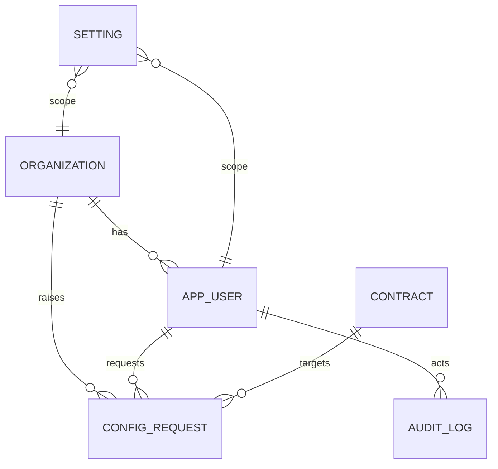

# Symmetry UI — final design & backend integration plan

Status: **implemented** (Harbor palette, lightweight ui-Settings-inspired, no glass).
Pages, router and the typed API client live in `ui/src/`; dev sign-in uses
`X-Symmetry-User` until Keycloak is connected. This is the contract between the
UI and the backend. If a screen needs data that is not listed here, the screen is
not ready to build.

Related: `docs/STACK.md` (stack), `docs/DESIGN.md` (product),
`docs/IMPLEMENTATION.md` (M1–M6), `docs/diagrams/uml_diagrams.md`.

---

## 0. Decisions locked

| # | Decision | Why |
|---|---|---|
| D1 | **Replace AWS Cloudscape** with a small custom design system + **Radix UI** primitives (headless a11y). | The mock is custom CSS; Cloudscape is AWS-looking and cannot be themed into light weight ui/Harbor. Heavy overrides cost more than owning ~15 primitives. |
| D2 | **Harbor** greyish-blue tokens, light + dark, **solid surfaces only** (no blur/`backdrop-filter`). | Owner choice; glass hurts legibility and looks dated. |
| D3 | **Remove the fake traffic lights.** Keep a slim 40 px title bar with the app name and role chip. | Browser tabs have no close/minimise semantics; fake controls mislead. The lightweight ui feel comes from the sidebar, cards, hairlines and type. |
| D4 | **System font stack**, not SF Pro. | SF Pro is not licensed for the web; `system-ui` renders SF on lightweight ui and Segoe on Windows. |
| D5 | **Auth = Keycloak** (Authorization Code + PKCE via `oidc-client-ts`), themed with Harbor. Admin is a realm **role**, not a separate system. | Credentials never touch our JS; MFA can be required for admins. |
| D6 | **Routes:** `/user/login`, `/user/admin/login`. Admin app lives under `/user/admin/*`. | Owner instruction. URL is UX only; authorization is server-side. |
| D7 | **Roles are distinct:** `WORKER`, `PUBLISHER`, `ADMIN`. | Owner instruction. Drives navigation, landing page and data scoping. |
| D8 | **Admin is read-only** over users/orgs, plus global/org **overrides**; orgs can **request** a task-specific tweak that an admin reviews. | Owner instruction; limits blast radius and PII exposure. |
| D9 | **Charts:** donut (≤5 parts) + bar/line. No pie walls. | light weightui -quiet charts and honest data visualisation. |
| D10 | **Config is data**, scoped `GLOBAL → ORG → CONTRACT → USER`, versioned and audited. | Per-task customisation without bespoke code paths. |
| D11 | **Realtime = SSE** (one-way), polling fallback. | Simpler than WebSocket for dashboards; survives proxies. |

---

## 1. Visual language — Harbor

### 1.1 Tokens (light)

| Token | Value | Use |
|---|---|---|
| `--bg` | `#edf0f5` | content background |
| `--sidebar` | `#e6eaf1` | sidebar + title bar |
| `--surface` | `#ffffff` | cards |
| `--surface-2` | `#f5f7fa` | row hover / segmented track |
| `--control` | `#fbfcfd` | inputs, selects |
| `--hover` | `#e9eef4` | nav hover |
| `--line` | `#d9dfe8` | hairlines |
| `--text` | `#1c2330` | primary text |
| `--muted` | `#67717f` | captions, meta |
| `--accent` | `#4a6b8a` | primary buttons, toggles |
| `--accent-weak` | `#dfe7f0` | selection, badges |
| `--success` | `#3f7d5a` | verified / passed |
| `--warning` | `#8a6a1f` | submitted / pending |
| `--danger` | `#a14b4b` | destructive / failed |
| `--info` | `#4a5578` | judged / informational |

### 1.2 Tokens (dark)

`--bg #171b21` · `--sidebar #1c2129` · `--surface #222831` ·
`--surface-2 #262d37` · `--control #1d232b` · `--hover #2a313b` ·
`--line #313a45` · `--text #e6eaf0` · `--muted #9aa4b2` ·
`--accent #7fa3c4` · `--accent-weak #2b3844` ·
`--success #7fbf9a` · `--warning #e0c06a` · `--danger #e08d8d` ·
`--info #9aa3c9`.

### 1.3 Shape, type, motion

- Radii: window `14`, card `10`, control `7`, pill `999`.
- Spacing scale: `4, 8, 12, 16, 20, 24, 28, 32`.
- Type: system stack; sizes `11 / 12 / 13.5 / 15 / 20 / 26`; weights `400 / 600 / 700`; headings `letter-spacing: -0.02em`.
- Shadows: window only (`0 24px 70px rgba(20,30,45,.20)`); cards use hairlines.
- Motion: `150–200 ms ease`; honour `prefers-reduced-motion`.
- **Hard rule:** no `backdrop-filter`, no translucent layers, no gradients behind text.

### 1.4 Accessibility (non-negotiable)

- Visible `:focus-visible` ring: 2 px `--accent`, 2 px offset.
- Body text ≥ AA contrast; muted text ≥ 4.5:1 on surface.
- Status never colour-only: badge text + dot.
- Row hit target ≥ 44 px; icon-only buttons get `aria-label`.
- Charts: axis labels, value labels, accessible summary table.

---

## 2. Roles, routes, guards

### 2.1 Route map

| Route | Role | Screen |
|---|---|---|
| `/` | any | redirect by session role |
| `/user/login` | public | worker/publisher sign-in |
| `/user/admin/login` | public | admin sign-in (same component, admin badge) |
| `/user/overview` | WORKER, PUBLISHER | role-specific home |
| `/user/contracts` | WORKER, PUBLISHER | list (publisher: own; worker: browse) |
| `/user/contracts/:moduleId/:version` | both | detail |
| `/user/contracts/:moduleId/:version/workbench` | WORKER | tier-filtered workbench + accept |
| `/user/workers` | PUBLISHER | workers who accepted / submitted |
| `/user/evaluations` | PUBLISHER | gate + ranking results |
| `/user/analytics` | PUBLISHER | org dashboards |
| `/user/payments` | PUBLISHER | payouts / invoices |
| `/user/settings` | both | profile, notifications, appearance |
| `/user/admin/overview` | ADMIN | ops home |
| `/user/admin/analytics` | ADMIN | platform dashboards |
| `/user/admin/orgs` | ADMIN | org directory (read-only) |
| `/user/admin/users` | ADMIN | user directory (read-only) |
| `/user/admin/troubleshooting` | ADMIN | live health, queues, errors |
| `/user/admin/config` | ADMIN | global/org overrides |
| `/user/admin/requests` | ADMIN | org config-tweak queue |
| `/user/admin/audit` | ADMIN | append-only audit log |

### 2.2 Guard rules

- `RequireAuth` → redirect to `/user/login` (admins to `/user/admin/login`).
- `RequireRole([...])` → 403 screen, never a silent blank.
- Redirect after login: `ADMIN → /user/admin/overview`, else `/user/overview`.
- **Server is authoritative:** every endpoint checks role + ownership
  (`@PreAuthorize`); route guards are UX only.

### 2.3 Navigation (cap 7 items)

- **Worker:** Overview · Browse contracts · My acceptances · Submissions · Earnings · Settings.
- **Publisher:** Overview · Contracts · Workers · Evaluations · Analytics · Payments · Settings.
- **Admin:** Overview · Analytics · Organizations · Users · Troubleshooting · Configuration · Requests · Audit.

---

## 3. Screen inventory

Each screen lists **purpose → components → data → states**.

### 3.1 Auth — `/user/login`, `/user/admin/login`
- Purpose: enter the product; same visual, admin gets an `Administrator` badge.
- Components: centred card, role hint, primary **Continue with Symmetry ID**, secondary
  **SSO**, links (Forgot password, Create account), theme toggle.
- Data: none (redirect to Keycloak); dev mode shows a **labelled** user picker.
- States: idle, redirecting, callback, error (`?error=`).

### 3.2 Worker — Overview
- Purpose: "what should I do now?".
- Components: KPI row (open contracts, my acceptances, submissions in flight,
  earnings), **Recommended contracts** list, recent activity, deadline cards.
- Data: `/worker/summary`, `/worker/acceptances`, `/contracts?page=`.
- States: skeleton KPIs, empty "no open contracts".

### 3.3 Worker — Browse / detail / workbench
- Purpose: understand the task, then sign acceptance.
- Components: filter bar (work kind, language, tier), contract rows, detail facts,
  disclosure-tier panel, workbench JSON viewer, **Accept** dialog (agreements
  checklist + signature status), signature result.
- Data: `/contracts`, `/contracts/{m}/{v}`, `/contracts/{m}/{v}/workbench`,
  `POST /contracts/{id}/accept`.
- States: 404, 400 bad signature, 409 already accepted, loading workbench.

### 3.4 Publisher — Overview
- Purpose: portfolio health.
- Components: KPI row (published, acceptance rate, evals running, spend),
  lifecycle donut, 30-day acceptance line, recent contracts, alerts.
- Data: `/org/summary`, `/org/analytics/overview`.
- States: first-run empty state ("publish your first contract").

### 3.5 Publisher — Contracts
- Purpose: create/manage job cards.
- Components: list (module, version, kind, tier, state), **New contract** wizard
  (basics → document → payload → review), detail tabs (Overview · Workbench ·
  Acceptances · Evaluations), state badge.
- Data: `POST /contracts`, `GET /org/contracts`, `GET /contracts/{m}/{v}`.
- States: validation errors per field, 409 duplicate, draft vs published.

### 3.6 Publisher — Workers / Evaluations / Payments
- Workers: accepted workers, signature verified, submission count, reputation.
- Evaluations: gate verdicts (pass/fail + failed checker), metric columns
  (time, memory), Pareto rank, sanitized failure text (no secrets).
- Payments: payable submissions, amounts, status, export CSV.
- Data: `/org/workers`, `/org/evaluations`, `/org/payments`.

### 3.7 Publisher / Worker — Settings
- Profile (name, email, timezone), notifications (acceptance, verdict),
  appearance (Harbor light/dark, reduce motion), security (sessions, MFA),
  API keys (publisher), delete account.
- Data: `/me`, `/me/settings`.

### 3.8 Admin — Overview & Analytics
- Overview: platform KPIs, live ops strip, incidents, pending requests.
- Analytics: contracts/day, accept rate, gate pass rate, queue latency,
  org activity; **donut** lifecycle mix + bar/line trends.
- Data: `/admin/summary`, `/admin/analytics/*`.

### 3.9 Admin — Troubleshooting
- Purpose: answer "why is this task stuck?".
- Components: search by contract/worker/job; timeline (published → accepted →
  submitted → built → gated → ranked); live queue depth; error rate; recent
  sanitized failures; **Copy diagnostic**.
- Data: `/admin/troubleshooting/*`, `/admin/stream` (SSE).
- States: live/disconnected, stale badge, no-match.

### 3.10 Admin — Configuration & Requests
- Configuration: scope switch (Global / Org / Contract / User), key list with
  resolved value + source, edit drawer, diff on save, "affects N" impact,
  dangerous zone behind confirm.
- Requests: org-submitted tweaks (key, value, reason, contract), approve/reject
  with note; approval writes the setting and the audit entry.
- **Read-only** user/org data; no impersonation.

### 3.11 Admin — Audit
- Append-only table: time, actor, role, action, target, before/after (diff),
  IP/UA; filters; export.

---

## 4. Component inventory (`ui/src/ui/`)

| Group | Components |
|---|---|
| Layout | `AppShell`, `TitleBar`, `Sidebar`, `SidebarGroup`, `NavItem`, `ContentPane`, `PageHeader` |
| Surfaces | `Card`, `Row`, `RowGroup`, `Divider`, `EmptyState` |
| Controls | `Button` (primary/secondary/ghost/danger), `IconButton`, `Switch`, `Segmented`, `Select`, `Input`, `SearchField`, `Checkbox`, `Radio`, `Tabs` |
| Feedback | `Badge`, `StatusDot`, `Toast`, `InlineError`, `Skeleton`, `Spinner`, `Dialog`, `ConfirmDialog`, `Drawer` |
| Data | `DataTable` (sort, paginate, empty/loading), `KeyValue`, `MonoBlock`, `Diff` |
| Charts | `DonutChart`, `BarChart`, `LineChart`, `Sparkline`, `ChartLegend`, `ChartTable` (a11y fallback) |
| Domain | `ContractRow`, `ContractStatus`, `TierBadge`, `SignatureCheck`, `VerdictBadge`, `MetricChip` |

Built on **Radix**: Dialog, Popover, Select, Tabs, Switch, Toast, Tooltip.
Charts: **Recharts** (custom tokens), every chart paired with `ChartTable`.
Code/log view: **CodeMirror 6** (replaces Cloudscape Monaco).

---

## 5. Auth design

- Flow: SPA → `/user/login` → **Continue** → Keycloak (PKCE) → callback →
  `/me` → route by role.
- Keycloak realm `symmetry`; roles `WORKER`, `PUBLISHER`, `ADMIN`.
- Admin: separate client or `kc_idp_hint`, **MFA required**; login screen is the
  same component with an `Administrator` badge at `/user/admin/login`.
- Token storage: `oidc-client-ts` in memory + sessionStorage; silent renew.
- Dev: `symmetry.security.enabled=false` → `/user/login` shows a clearly
  labelled **Dev sign-in** picker (no password); never shipped in production.
- Logout: Keycloak end-session; clear query cache.
- **Keycloak login page is themed** with the Harbor tokens (FreeMarker theme),
  so the redirect does not break the visual language.

---

## 6. Backend contract

All paths are canonical; the Vite dev server proxies `/api` and strips it
(`ui/vite.config.ts`).

### 6.1 Existing (keep)

| Method | Path | Notes |
|---|---|---|
| `POST` | `/contracts` | publish (publisher/admin) |
| `GET` | `/contracts` | paged list |
| `GET` | `/contracts/{moduleId}/{version}` | detail |
| `GET` | `/contracts/{moduleId}/{version}/workbench` | tier-filtered |
| `POST` | `/contracts/{id}/accept` | signed acceptance |

### 6.2 Identity & settings

| Method | Path | Role | Returns |
|---|---|---|---|
| `GET` | `/me` | any | `{id, email, name, role, orgId, orgSlug, settings}` |
| `GET` | `/me/settings` | any | effective settings map |
| `PATCH` | `/me/settings` | any | writes `USER`-scoped values, returns effective map |
| `GET` | `/worker/summary` | WORKER | acceptances, verified, earnings (offline) |
| `GET` | `/worker/acceptances` | WORKER | acceptances joined to contracts |
| `GET` | `/worker/submissions` | WORKER | empty + offline note (V1) |
| `GET` | `/worker/earnings` | WORKER | zeroed totals (V1) |

### 6.3 Publisher

`GET /org/summary` · `GET /org/contracts` · `GET /org/workers` ·
`GET /org/evaluations` · `GET /org/payments` ·
`GET /org/analytics/overview?days=` ·
`GET /org/analytics/contracts-by-state` · `GET /org/analytics/acceptances-by-day` ·
`GET /org/analytics/top-modules` · `GET /org/analytics/verification` ·
`GET /org/analytics/funnel` · `GET /org/settings/effective` ·
`GET|POST /org/config-requests` · `GET /org/stream` (SSE).

### 6.4 Admin

`GET /admin/summary` · `GET /admin/analytics/overview?days=` ·
`GET /admin/analytics/contracts-by-state` · `GET /admin/analytics/acceptances-by-day` ·
`GET /admin/analytics/top-modules` · `GET /admin/analytics/verification` ·
`GET /admin/analytics/funnel` · `GET /admin/organizations` ·
`GET /admin/users?role=&orgId=` ·
`GET /admin/troubleshooting/health|queues|errors` ·
`GET /admin/audit?action=&actorId=` ·
`GET /admin/config` · `PUT /admin/config/global/{key}` ·
`GET /admin/config/requests?status=` ·
`POST /admin/config/requests/{id}/approve|reject` · `GET /admin/stream` (SSE).

### 6.5 Error shape (all endpoints)

```json
{ "type": "about:blank", "title": "Conflict", "status": 409,
  "detail": "Worker already accepted this contract", "instance": "/contracts/..." }
```

UI maps `400` inline, `401` → login, `403` → role screen, `404` → empty,
`409` → conflict toast, `5xx` → retry panel.

---

## 7. Data model additions (Flyway `V2__identity_config_audit.sql`)

```sql
organization(id uuid pk, slug text unique, name text, status text, created_at)
app_user(id uuid pk, subject text unique, email text unique, display_name text,
         role text check in (WORKER,PUBLISHER,ADMIN),
         org_id uuid null references organization, status text, created_at, updated_at)
setting(id uuid pk, scope text check in (GLOBAL,ORG,CONTRACT,USER),
        scope_id uuid null, key text, value jsonb, version int,
        updated_by uuid, updated_at,
        unique(scope, scope_id, key))
config_request(id uuid pk, org_id uuid, contract_id uuid null, requested_by uuid,
        key text, value jsonb, reason text,
        status text check in (PENDING,APPROVED,REJECTED,APPLIED),
        reviewed_by uuid, reviewed_at, review_note text, created_at)
audit_log(id bigserial pk, actor_id uuid, actor_role text, action text,
        target_type text, target_id text, before jsonb, after jsonb,
        ip inet, user_agent text, created_at timestamptz default now())
```

Rules:
- **Identity:** Keycloak owns passwords; `app_user` mirrors `sub` on first login.
- **Config precedence:** `USER > CONTRACT > ORG > GLOBAL`, resolved server-side.
- **Audit:** append-only; the app role may `INSERT`/`SELECT`, never `UPDATE`/`DELETE`.
- **Secrets:** write-only, never returned; masked in the UI.
- Planned (M2–M6): `submission`, `verdict`, `metric`, `payment` — not in V2.



---

## 8. Config workflow (org asks, admin decides)

1. Org opens **Settings → Task overrides** (or a contract's detail page) and
   submits `key`, `value`, `reason`, optional `contractId`.
2. `POST /org/config-requests` stores `PENDING` + audit entry.
3. Admin sees **Requests**, reviews the diff and impact, approves/rejects.
4. Approve → upsert `setting(scope=CONTRACT|ORG)` → `APPLIED` → audit
   (`before`/`after`).
5. Resolution order applies immediately (cache invalidated).

Guarded keys only: an allow-list of known keys with types/ranges; unknown keys
are rejected at request time. Dangerous keys (limits, sandbox, payments) require
an explicit confirm.

---

## 9. Analytics & realtime

- **Sources:** SQL aggregates / materialised views refreshed on a schedule.
  Never query Prometheus from the browser.
- **Views:** `v_contract_funnel`, `v_acceptance_daily`, `v_eval_quality`,
  `v_worker_activity`, `v_queue_health`.
- **Endpoints** return small pre-aggregated arrays (max ~90 points), cached 30 s.
- **SSE** payloads: `contract.accepted`, `eval.started`, `eval.finished`,
  `queue.depth`, `error.rate`; `Last-Event-ID` replay window 5 min; polling
  fallback every 15 s.
- **Charts:** one donut max per view; bar = comparison; line = trend; stacked
  bar = state over time; always show the table fallback.

---

## 10. Security rules

- Role + ownership enforced in Spring (`@PreAuthorize`), not the SPA.
- Publisher queries always filter by `org_id` from the token.
- Worker sees only their own acceptances/submissions.
- Admin read-only on user/org records; config writes audited.
- No impersonation in V1.
- Rate limit auth and write paths (Bucket4j, already planned).
- Never log tokens, signatures, or hidden task data.

---

## 11. Phasing

| Phase | Deliverable | Verify |
|---|---|---|
| P0 | This document + `STACK.md` reconciliation | review |
| P1 | Harbor tokens, `AppShell`, primitives, static login | `npm ci && npm run build` |
| P2 | Routes + role guards + static pages (mock data) | `npm run build` |
| P3 | `V2` migration + `/me`, settings, org/worker scoping | `./mvnw -B verify` |
| P4 | Analytics endpoints + charts | both |
| P5 | Admin troubleshooting/config/requests/audit | both |
| P6 | SSE realtime + fallback | both |
| P7 | Keycloak theme, MFA, production auth | manual + tests |

---

## 12. Risks / pushback (kept on purpose)

- **Cloudscape removal** costs tested components; we pay with Radix + tests.
- **lightweight ui inspiration** must not break web expectations (targets, focus, links).
- **Config sprawl** is the main risk: allow-listed keys + audit + scope caps.
- **Realtime** can become noise: live only where actionable.
- **Two login routes** are cosmetic; a wrong route must still be rejected by
  the server.
