# Symmetry — UML & System Interaction Design

> Audience: engineers, operators, and stakeholders. This document is written
> **class first**: each class is described, then every software interface and
> database it touches, then the use case it serves. Overview diagrams come first
> so you can zoom in with context.
>
> **Legend for status:** ✅ implemented (V1 / M1–M1b) · 🔜 planned (M2–M6 / build
> track). Planned elements are shown so the design is auditable, but they are not
> in the code yet.
>
> Source of truth for the plan: `docs/DESIGN.md`, `docs/IMPLEMENTATION.md`,
> `docs/STACK.md`. This file is the **UML/interface view** of the code as built.

**Visual / editable version:** [`symmetry-uml.drawio`](./symmetry-uml.drawio) —
open it at <https://app.diagrams.net> (draw.io). It is built from **native
draw.io objects**: UML class boxes, actors, lifelines, entity boxes, and
connectors where **solid = implemented** and **dashed / dotted = planned**. The
Mermaid diagrams below render on GitHub; the `.drawio` file is the one to edit.

## Diagram index

| # | Diagram | Kind |
|---|---|---|
| D1 | Stakeholders & actors | Use-case context |
| D2 | System context & deployment | Deployment |
| D3 | Component / interface map | Component |
| D4 | Domain class model | Class |
| D5 | Database schema | ER |
| D6–D25 | Per-class interaction diagrams | Class / Sequence |
| D26–D33 | Use-case sequence diagrams | Sequence |

---

## 1. Stakeholders & actors (D1)

**D1 — Actors and their goals**

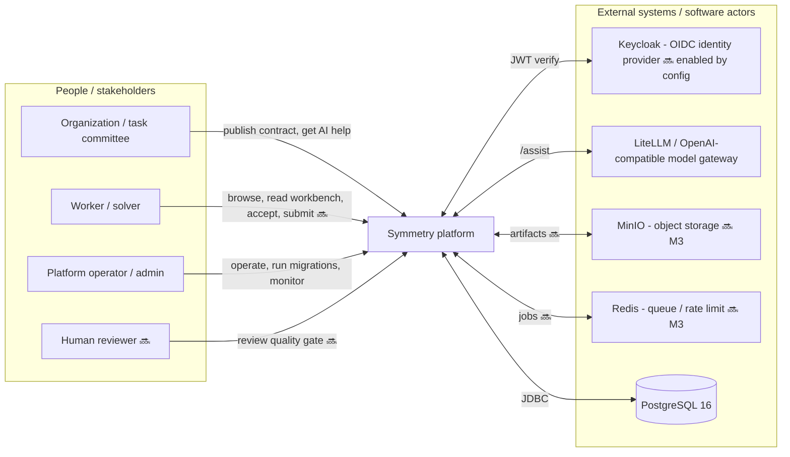

### Use-case catalog

| ID | Use case | Primary actor | Status | Data touched |
|---|---|---|---|---|
| UC-01 | Publish a contract (task document + payload) | Organization | ✅ | `contract` INSERT |
| UC-02 | Browse / list contracts (paged) | Organization, Worker | ✅ | `contract` SELECT |
| UC-03 | View one contract by id@version | Any | ✅ | `contract` SELECT |
| UC-04 | Read the tier-filtered workbench | Worker | ✅ | `contract` SELECT (+ disclosure filter) |
| UC-05 | Accept the task document (signed) | Worker | ✅ | `contract` SELECT+UPDATE, `acceptance` INSERT |
| UC-06 | Authenticate via OIDC/JWT | Any | 🔜 (toggle) | none (token only) |
| UC-07 | Ask the AI assistant (org/worker role) | Organization, Worker | ✅ | none (audit log line) |
| UC-08 | Submit a solution → build → gate → rank | Worker | 🔜 M2–M6 | 🔜 `submission`, `verdict`, `metrics` |
| UC-09 | Publish a new-build brief / proposal | Organization, Reviewer | 🔜 build track | 🔜 `brief`, `proposal` |

---

## 2. System context & deployment (D2)

**D2 — Deployment view (Docker Compose / process boundaries)**

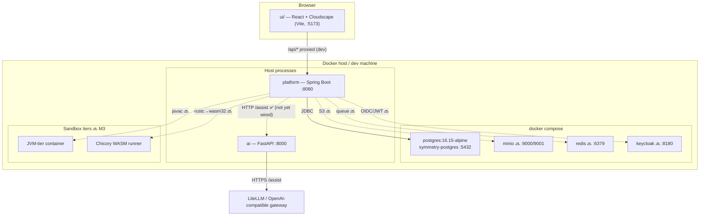

Ports: UI `5173`, platform `8080`, AI `8000`, Postgres `5432`, MinIO `9000/9001`,
Redis `6379`, Keycloak `8180`. Source: `deploy/docker-compose.yml`,
`ui/vite.config.ts`.

---

## 3. Component / interface map (D3)

**D3 — Components and the contracts between them**

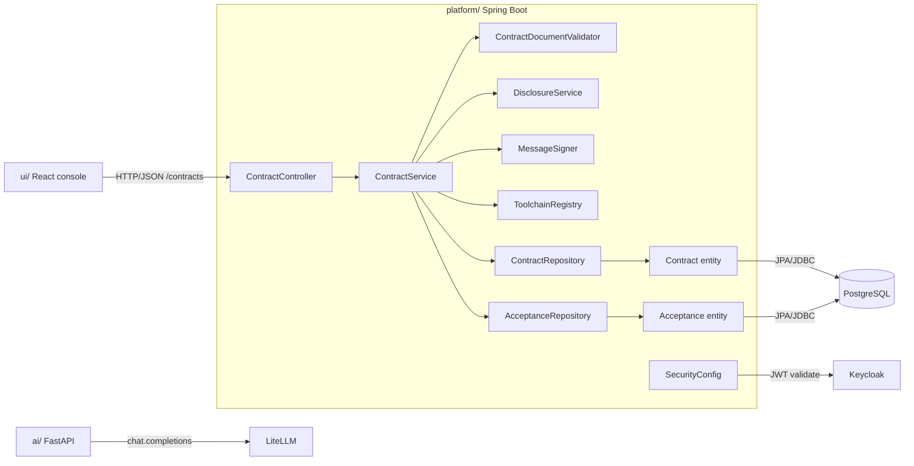

---

## 4. Domain class model (D4)

**D4 — Implemented classes and relationships**

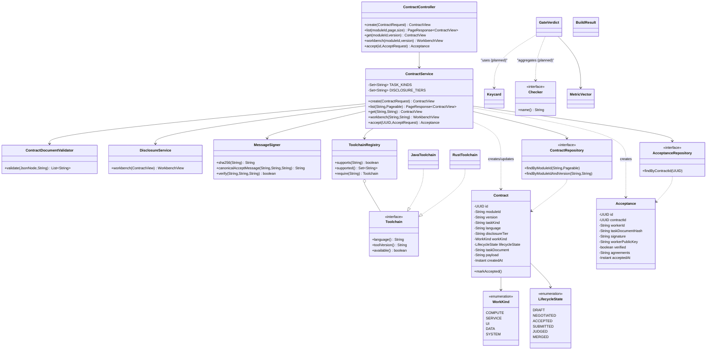

Note: `Contract`/`Acceptance` are JPA entities; `payload`/`agreements` are stored
as `jsonb` via Hibernate's `@JdbcTypeCode(SqlTypes.JSON)`.

---

## 5. Database schema (D5)

**D5 — Entity relationship (PostgreSQL 16, Flyway `V1__baseline.sql`)**

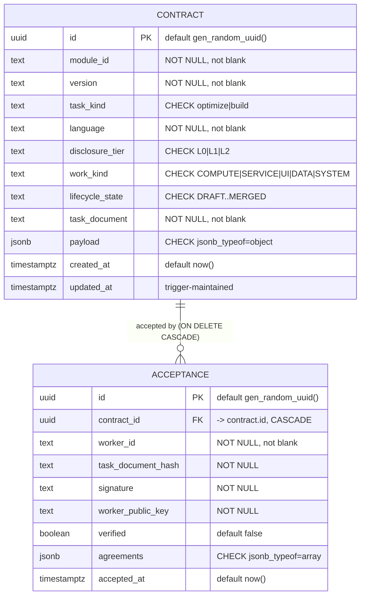

Indexes/constraints (from `V1__baseline.sql`):
- `uq_contract_module_version UNIQUE (module_id, version)` — also serves list-by-module.
- `idx_contract_payload GIN (payload jsonb_path_ops)` — payload queries.
- `uq_acceptance_contract_worker UNIQUE (contract_id, worker_id)` — one acceptance per worker; also serves `findByContractId`.
- `idx_acceptance_worker_id` — "everything this worker accepted".
- `trg_contract_set_updated_at` — sets `updated_at` on UPDATE.

### 5.1 Class → table access matrix

| Class | Table | Operation | Notes |
|---|---|---|---|
| `ContractService.create` | `contract` | SELECT (dup check) + INSERT/UPDATE | 409 on race/duplicate |
| `ContractService.list` | `contract` | SELECT (paged, ORDER BY created_at DESC) | via `ContractRepository` |
| `ContractService.get` | `contract` | SELECT (module_id+version) | 404 if absent |
| `ContractService.workbench` | `contract` | SELECT | then disclosure filter (no write) |
| `ContractService.accept` | `contract` | SELECT + UPDATE `lifecycle_state` | `markAccepted()` |
| `ContractService.accept` | `acceptance` | INSERT (flush inside try) | 409 on `(contract_id,worker_id)` dup |
| `AcceptanceRepository` | `acceptance` | SELECT by `contract_id` | 🔜 used by trust/submission |
| all entities | — | DDL owned by Flyway | `ddl-auto=validate` |

---

## 6. Per-class interaction diagrams (D6–D25)

For each class: **responsibility → software interfaces → database → use cases →
diagram**.

### D6 — `PlatformApplication` (bootstrap, ✅)
- **Responsibility:** Spring Boot entry point; starts component scan, JPA,
  Flyway, security.
- **Interfaces:** Spring Boot auto-config, HikariCP pool → PostgreSQL, Flyway →
  `db/migration`, Actuator `/actuator/health`.
- **DB:** owns startup: runs Flyway `V1__baseline.sql`; Hibernate `validate`.
- **Use cases:** enables all.

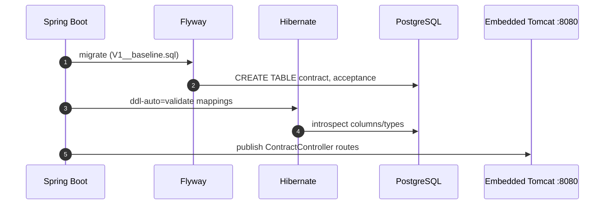

### D7 — `ContractController` (REST boundary, ✅)
- **Responsibility:** HTTP/JSON adapter. No business rules.
- **Interfaces:** Spring MVC (`@RestController`, `@RequestMapping("/contracts")`),
  Bean Validation (`@Valid`), Jackson 3 (`tools.jackson`) for JSON.
- **DB:** none directly (delegates to `ContractService`).
- **Use cases:** UC-01 (`POST`), UC-02 (`GET` list), UC-03 (`GET`), UC-04
  (`GET .../workbench`), UC-05 (`POST .../accept`).
- **Endpoints:** `POST /contracts` (201), `GET /contracts?moduleId&page&size`,
  `GET /contracts/{moduleId}/{version}`,
  `GET /contracts/{moduleId}/{version}/workbench`,
  `POST /contracts/{id}/accept` (201).

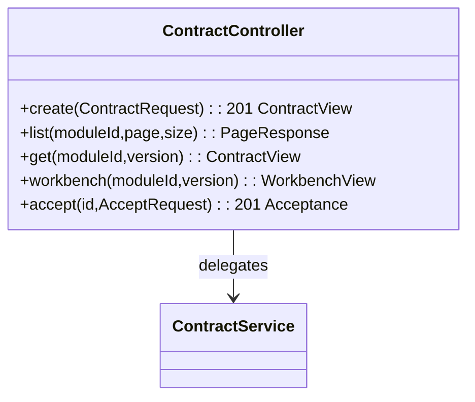

### D8 — `ContractService` (application service, ✅)
- **Responsibility:** orchestration + the rules: allow-lists (`TASK_KINDS`,
  `DISCLOSURE_TIERS`), toolchain support, document validation, uniqueness, signed
  acceptance, lifecycle transition.
- **Interfaces:** Spring `@Service`, `@Transactional`,
  `@Value("${symmetry.acceptance.required-agreements}")`, Spring
  `DataIntegrityViolationException` translation, Jackson for payload read/write.
- **DB:** `contract` (SELECT/INSERT/UPDATE), `acceptance` (INSERT).
- **Use cases:** UC-01…UC-05.

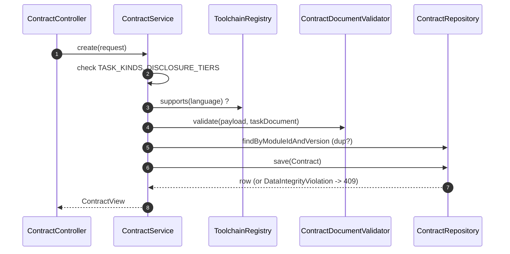

### D9 — `ContractDocumentValidator` (domain validator, ✅)
- **Responsibility:** reject bad task documents before storage; returns **all**
  problems.
- **Interfaces:** Jackson `JsonNode` (structure walking).
- **DB:** none.
- **Use case:** UC-01.
- **Rules:** `taskDocument` non-blank; payload is an object; required objects
  `signature`, `oracle`, `scoring`; non-empty `invariants`; positive
  `resourceBudget.{timeMs,peakMemMb,artifactKb}`.

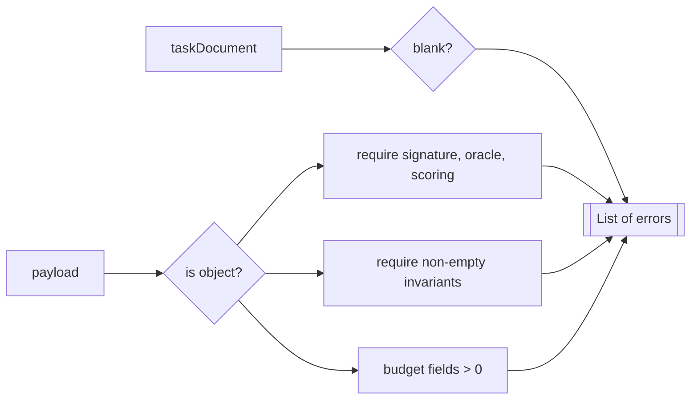

### D10 — `DisclosureService` (policy component, ✅)
- **Responsibility:** produce the tier-filtered workbench; **secrets never
  travel** (holdout/oracle internals removed at every tier).
- **Interfaces:** Jackson `ObjectNode` deep copy/remove.
- **DB:** none (pure function of a `ContractView`).
- **Use case:** UC-04.
- **Tiers:** `L0` (no samples/realExamples) · `L1` (no realExamples) · `L2` (all
  except holdout).

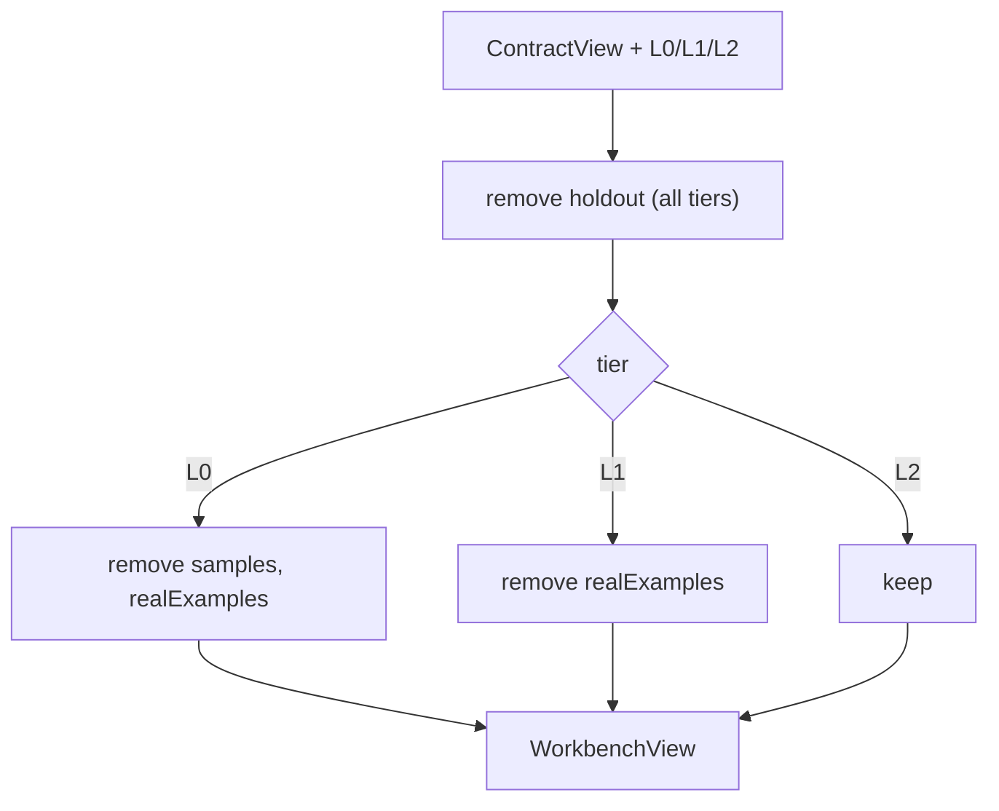

### D11 — `MessageSigner` (crypto utility, ✅)
- **Responsibility:** hash the task document, build the canonical acceptance
  message, verify Ed25519 signatures. Fail-closed on malformed input.
- **Interfaces:** `java.security` (`MessageDigest` SHA-256, `KeyFactory`,
  `Signature` Ed25519), `java.util.Base64`, `java.util.HexFormat`.
- **DB:** none.
- **Use case:** UC-05.
- **Canonical message:** `accept:<moduleId>@<version>:<sha256(taskDocument)>`.

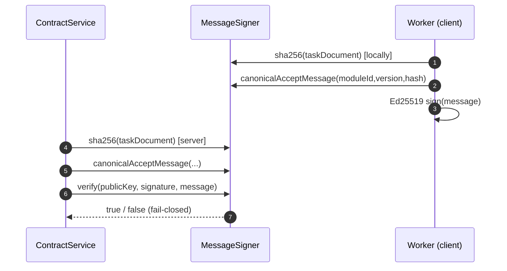

### D12 — `Contract` entity (JPA, ✅)
- **Responsibility:** job-card row.
- **Interfaces:** JPA/Hibernate (`@Entity @Table("contract")`),
  `@JdbcTypeCode(SqlTypes.JSON)` for `payload` jsonb, `Instant`↔`timestamptz`.
- **DB:** `contract` (all columns).
- **Use cases:** UC-01…UC-05 (read/update).

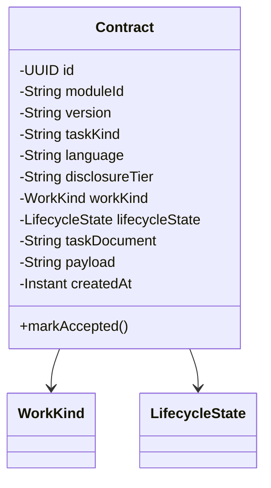

### D13 — `Acceptance` entity (JPA, ✅)
- **Responsibility:** signed proof a worker accepted a task document.
- **Interfaces:** JPA/Hibernate; `@JdbcTypeCode(SqlTypes.JSON)` for `agreements`.
- **DB:** `acceptance`; FK `contract_id ON DELETE CASCADE`.
- **Use case:** UC-05.

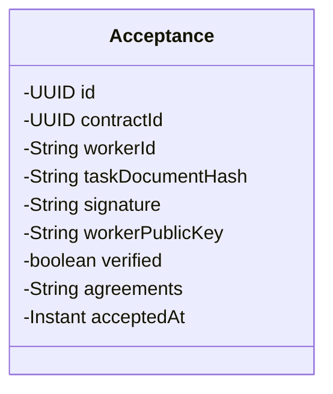

### D14 — `ContractRepository` / `AcceptanceRepository` (Spring Data, ✅)
- **Responsibility:** persistence ports.
- **Interfaces:** Spring Data JPA (derived queries).
- **DB:** `contract`, `acceptance`.
- **Use cases:** all reads/writes.

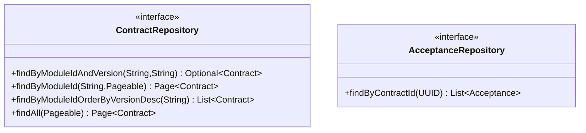

### D15 — DTO records `ContractRequest`, `AcceptRequest` (✅)
- **Responsibility:** request shapes + Bean Validation.
- **Interfaces:** Jakarta Validation (`@NotBlank`, `@NotEmpty`), Jackson.
- **DB:** none.
- **Use cases:** UC-01 (`ContractRequest`), UC-05 (`AcceptRequest`).

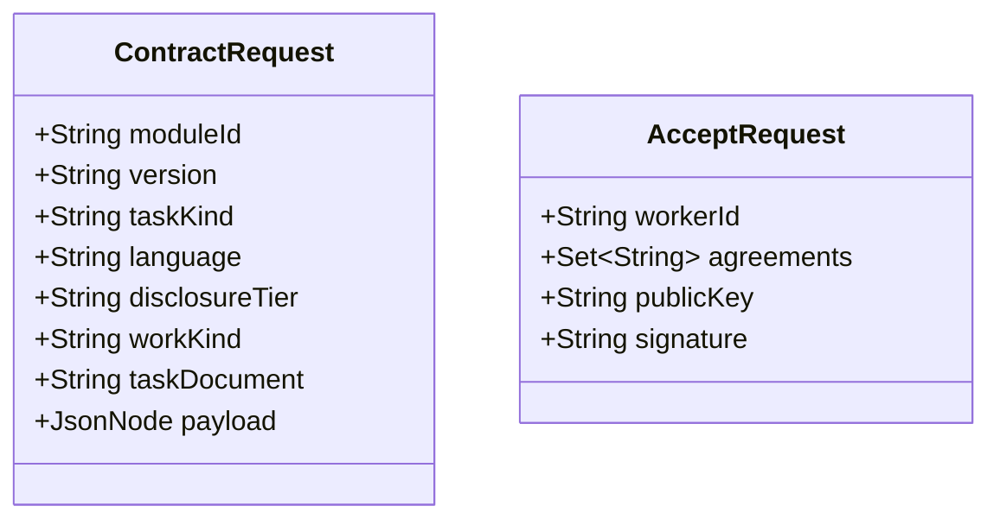

### D16 — DTO records `ContractView`, `WorkbenchView`, `PageResponse` (✅)
- **Responsibility:** response shapes (envelope-stable).
- **Interfaces:** Jackson serialization; `PageResponse` adapts Spring Data
  `Page`.
- **DB:** none.
- **Use cases:** UC-02/03 (`ContractView`), UC-04 (`WorkbenchView`), UC-02
  (`PageResponse`).

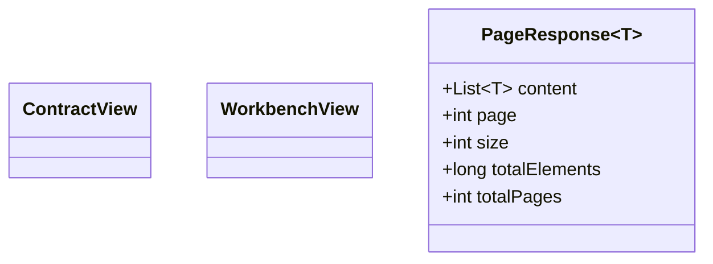

### D17 — `WorkKind` (enum, ✅)
- **Responsibility:** label for the kind of work (socket 1). V1 uses `COMPUTE`.
- **Interfaces:** JPA `@Enumerated(STRING)` stored in `contract.work_kind`.
- **Use case:** UC-01 (set), UC-02/04 (shown).

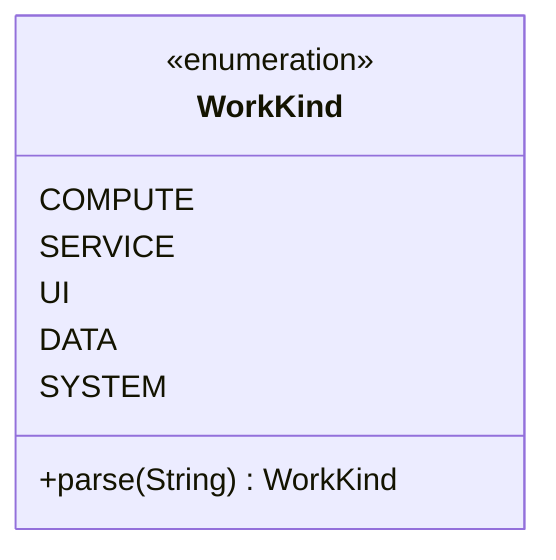

### D18 — `LifecycleState` (enum, ✅)
- **Responsibility:** the state machine (socket 7); V1 walks
  `DRAFT → ACCEPTED`.
- **Interfaces:** stored in `contract.lifecycle_state`.
- **Use case:** UC-05 (transition), UC-02/03 (shown).

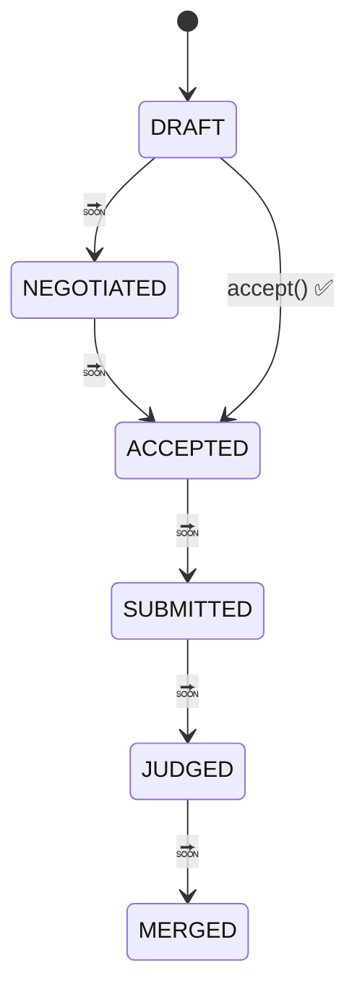

### D19 — `Toolchain` + `JavaToolchain` + `RustToolchain` (plugin, ✅ stubs)
- **Responsibility:** compile a submission with a pinned tool (socket 6).
- **Interfaces:** Spring `@Component` discovery; planned `javac` (JVM tier) and
  `rustc --target wasm32-unknown-unknown` (Chicory).
- **DB:** none.
- **Use cases:** UC-01 (language must be known), UC-08 🔜.

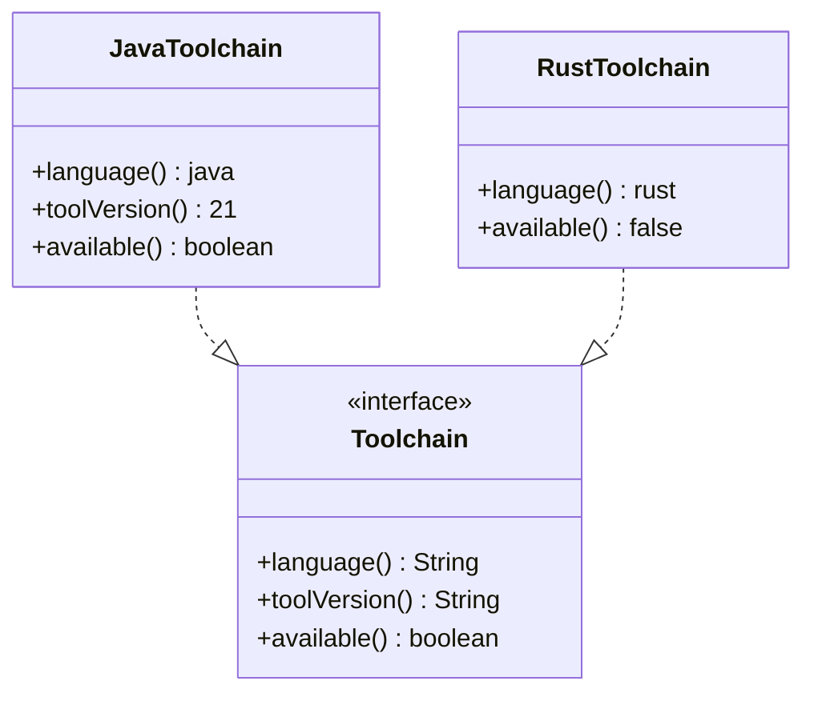

### D20 — `ToolchainRegistry` (registry, ✅)
- **Responsibility:** map language → `Toolchain`; `supports()` means "platform
  knows it", independent of whether the compiler is installed here.
- **Interfaces:** Spring injects `List<Toolchain>`.
- **DB:** none.
- **Use case:** UC-01 (gate), UC-08 🔜.

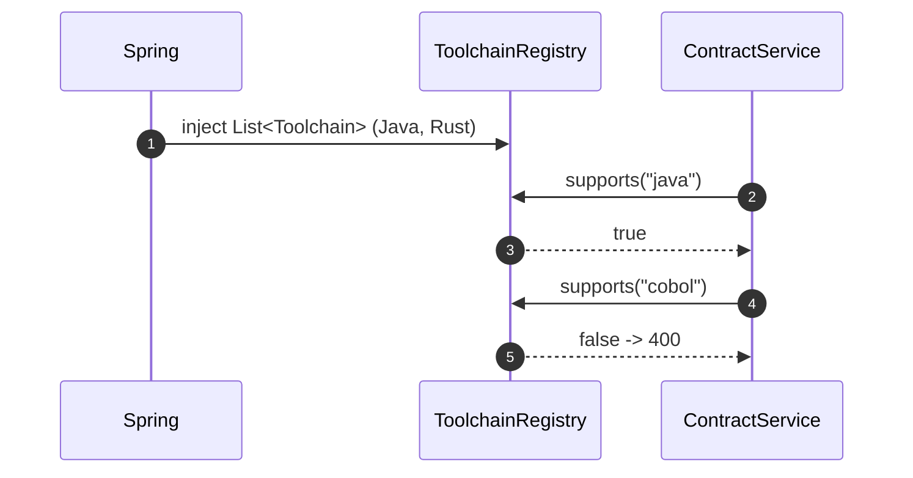

### D21 — `BuildResult` (value, ✅ / used 🔜)
- **Responsibility:** outcome of a pinned build: fingerprint, tool version,
  reproducibility.
- **DB:** none (🔜 persisted with submissions).

```mermaid
classDiagram
    class BuildResult {
      +String artifactFingerprint
      +String toolVersion
      +boolean reproducible
    }
```

### D22 — `Checker` + `GateVerdict` (gate, ✅ types / used 🔜 M4)
- **Responsibility:** the gate is a **list** of checkers; `GateVerdict` is the
  worker-safe outcome (never leaks hidden data).
- **Interfaces:** 🔜 sandbox runners; Jackson for the sanitized message.
- **DB:** none (🔜 verdict row).
- **Use case:** UC-08 🔜.

```mermaid
classDiagram
    class Checker {
      <<interface>>
      +name() String
    }
    class GateVerdict {
      +boolean passed
      +String failedChecker
      +String sanitizedMessage
      +MetricVector metrics
      +pass(Map) GateVerdict
      +fail(String,String) GateVerdict
    }
    class MetricVector
    GateVerdict --> MetricVector
```

### D23 — `Keycard` (capabilities, ✅)
- **Responsibility:** what a module may touch at run time (socket 5). V1 =
  `EMPTY` (no network/fs/clock/randomness, 1 thread).
- **Interfaces:** 🔜 enforced by sandbox tiers.
- **DB:** none.

```mermaid
classDiagram
    class Keycard {
      +boolean network
      +boolean filesystem
      +boolean clock
      +boolean randomness
      +int maxThreads
      +Keycard EMPTY
    }
```

### D24 — `MetricVector` (scoring, ✅)
- **Responsibility:** flexible named measurements (socket 4) so new domains need
  no schema change; immutable builder.
- **DB:** none (🔜 metrics column).
- **Use case:** UC-08 🔜.

```mermaid
classDiagram
    class MetricVector {
      -Map~String,Double~ metrics
      +of(...) MetricVector
      +get(String) OptionalDouble
      +with(String,double) MetricVector
    }
```

### D25 — `SecurityConfig` (security, ✅ toggle)
- **Responsibility:** off by default (dev/tests); when
  `symmetry.security.enabled=true`, require a JWT from an OAuth2 issuer
  (Keycloak), leaving `/actuator/health/**` open.
- **Interfaces:** Spring Security `SecurityFilterChain`, `oauth2ResourceServer`.
- **DB:** none.
- **Use case:** UC-06 🔜.

```mermaid
flowchart TB
    Q{"symmetry.security.enabled?"}
    Q -->|false / missing| OPEN["openFilterChain: permitAll (dev)"]
    Q -->|true| JWT["jwtFilterChain: health open, all else authenticated"]
    JWT --> ISS["OAuth2 issuer (Keycloak) JWT validation"]
```

### D25b — UI classes `ui/src/api.ts` + `ui/src/App.tsx` (✅)
- **Responsibility:** `api.ts` = typed fetch client + `Contract`/`Page<T>`
  interfaces; `App.tsx` = Cloudscape console (Contracts table + TanStack Query).
- **Interfaces:** Fetch API → `/api/contracts` (Vite dev proxy rewrites `/api`
  → `:8080`); Cloudscape components.
- **DB:** none (reads via platform).
- **Use cases:** UC-02 (table), UC-01/03/04/05 (🔜 buttons).

```mermaid
sequenceDiagram
    autonumber
    participant U as User
    participant App as App.tsx (Cloudscape)
    participant API as api.ts
    participant Vite as Vite proxy /api
    participant Plat as platform :8080 /contracts
    U->>App: open console
    App->>API: listContracts(page,size)
    API->>Vite: GET /api/contracts
    Vite->>Plat: GET /contracts (rewrite)
    Plat-->>Vite: PageResponse~ContractView~
    Vite-->>API: JSON
    API-->>App: Page~Contract~
```

### D25c — AI classes `ai/app/main.py` (✅)
- **Responsibility:** FastAPI service exposing `GET /health` and
  `POST /assist`; two roles (`org`, `worker`); audit log; guardrail that refuses
  hidden test data for the worker role; TIMEOUT + 502 on gateway failure.
- **Interfaces:** FastAPI/Pydantic, OpenAI-compatible client → LiteLLM
  (`SYMMETRY_AI_BASE_URL`), Python logging audit.
- **DB:** none.
- **Use case:** UC-07.

```mermaid
sequenceDiagram
    autonumber
    participant User
    participant API as FastAPI /assist
    participant Guard as Guardrail
    participant Audit as audit log
    participant GW as LiteLLM gateway
    User->>API: AssistRequest(role,prompt,context)
    API->>Guard: worker + context has "holdout"?
    Guard-->>User: 400 (refuse)
    API->>Audit: log role/model/lengths (no bodies)
    API->>GW: chat.completions.create(model,messages)
    alt gateway ok
      GW-->>API: content
      API-->>User: AssistResponse
    else gateway error
      API-->>User: 502
    end
```

### D25d — WASM SDK `wasm-sdk/sdk/src/lib.rs` (✅ ABI / used 🔜)
- **Responsibility:** ABI for Rust modules: `symmetry_alloc`,
  `symmetry_dealloc`, `read_input`, `export_bytes` (length-prefixed buffers).
- **Interfaces:** `wasm32-unknown-unknown`; host = Chicory (Java) with no host
  imports.
- **Use case:** UC-08 🔜.

```mermaid
sequenceDiagram
    autonumber
    participant H as Host (Chicory)
    participant M as Wasm module
    H->>M: symmetry_alloc(input_len)
    M-->>H: ptr
    H->>M: write input bytes
    H->>M: run(ptr, len)
    M->>M: read_input / transform / export_bytes
    M-->>H: out_ptr [u64 len][payload]
    H->>M: symmetry_dealloc(ptr,len)
```

---

## 7. Use-case sequence diagrams (D26–D33)

### D26 — UC-01 Publish a contract ✅
```mermaid
sequenceDiagram
    autonumber
    actor Org as Organization
    participant UI as Console
    participant C as ContractController
    participant S as ContractService
    participant V as ContractDocumentValidator
    participant R as ToolchainRegistry
    participant DB as ContractRepository
    Org->>UI: fill contract form (🔜 form)
    UI->>C: POST /contracts ContractRequest
    C->>S: create(request)
    S->>S: allow-list taskKind, disclosureTier
    S->>R: supports(language)?
    S->>V: validate(payload, taskDocument)
    S->>DB: exists moduleId@version?
    alt duplicate / race
      DB-->>S: conflict
      S-->>C: 409
    else ok
      S->>DB: INSERT contract
      DB-->>S: row
      S-->>C: ContractView
      C-->>UI: 201
    end
```

### D27 — UC-02 List / browse contracts ✅
```mermaid
sequenceDiagram
    autonumber
    actor User
    participant UI as Console
    participant C as ContractController
    participant S as ContractService
    participant DB as ContractRepository
    User->>UI: open Contracts
    UI->>C: GET /contracts?moduleId&page&size
    C->>C: clamp page/size (max 200), sort created_at DESC
    C->>S: list(moduleId, pageable)
    S->>DB: findAll / findByModuleId
    DB-->>S: Page<Contract>
    S-->>C: PageResponse<ContractView>
    C-->>UI: 200 JSON
```

### D28 — UC-04 Read the workbench ✅
```mermaid
sequenceDiagram
    autonumber
    actor Worker
    participant C as ContractController
    participant S as ContractService
    participant DB as ContractRepository
    participant D as DisclosureService
    Worker->>C: GET /contracts/{moduleId}/{version}/workbench
    C->>S: workbench(moduleId,version)
    S->>DB: findByModuleIdAndVersion
    alt not found
      S-->>C: 404
    else found
      S->>D: workbench(ContractView)
      D->>D: strip holdout (all tiers), apply tier
      D-->>S: WorkbenchView
      S-->>C: WorkbenchView
      C-->>Worker: 200 (no secrets)
    end
```

### D29 — UC-05 Accept a task document ✅ (the trust gate)
```mermaid
sequenceDiagram
    autonumber
    actor Worker
    participant C as ContractController
    participant S as ContractService
    participant M as MessageSigner
    participant DBc as ContractRepository
    participant DBa as AcceptanceRepository
    Worker->>C: POST /contracts/{id}/accept AcceptRequest
    C->>S: accept(id, request)
    S->>DBc: findById(id)
    alt not found
      S-->>C: 404
    end
    S->>S: required agreement subset check
    alt missing agreement
      S-->>C: 400
    end
    S->>M: sha256(taskDocument) + canonicalAcceptMessage
    S->>M: verify(publicKey, signature, message)
    alt bad signature
      S-->>C: 400 (fail closed)
    end
    S->>DBc: UPDATE lifecycle_state = ACCEPTED
    S->>DBa: INSERT acceptance (flush in try)
    alt duplicate (contract_id, worker_id)
      DBa-->>S: DataIntegrityViolation
      S-->>C: 409
    else ok
      DBa-->>S: Acceptance
      S-->>C: 201 Acceptance
    end
```

### D30 — UC-06 Authenticate (security enabled) 🔜
```mermaid
sequenceDiagram
    autonumber
    actor User
    participant UI as Console
    participant KC as Keycloak
    participant F as Spring Security JWT filter
    participant C as ContractController
    User->>KC: login
    KC-->>UI: access token (JWT)
    UI->>F: request + Authorization: Bearer
    F->>KC: fetch JWKS / validate issuer+signature
    alt invalid
      F-->>UI: 401
    else valid
      F->>C: proceed (authenticated)
      C-->>UI: 200
    end
```

### D31 — UC-07 AI assist ✅
```mermaid
sequenceDiagram
    autonumber
    actor User as Org / Worker
    participant AI as ai FastAPI /assist
    participant GW as LiteLLM gateway
    User->>AI: POST /assist {role, prompt, context}
    AI->>AI: guardrail + audit log
    AI->>GW: chat.completions.create
    GW-->>AI: content
    AI-->>User: AssistResponse
    Note over AI,GW: role=worker must never carry hidden tests
```

### D32 — UC-08 Submit → build → gate → rank 🔜 (M2–M6)
```mermaid
sequenceDiagram
    autonumber
    actor Worker
    participant API as platform
    participant REG as ToolchainRegistry
    participant SAND as Sandbox (JVM tier / Chicory)
    participant GATE as Checker list
    participant SCORE as MetricVector ranking
    Worker->>API: submit solution (needs prior acceptance)
    API->>REG: require(language) + pinned build
    REG->>SAND: compile + run with Keycard (EMPTY in V1)
    SAND->>GATE: correctness checkpoints (property/fuzz/holdout)
    alt gate fails
      GATE-->>Worker: sanitized failure (no secrets)
    else all pass
      GATE->>SCORE: metrics for passing submissions only
      SCORE-->>Worker: rank (Pareto)
    end
```

### D33 — UC-09 New-build brief / proposal 🔜 (build track)
```mermaid
sequenceDiagram
    autonumber
    actor Org as Organization
    actor Rev as Reviewer
    participant API as platform
    Org->>API: publish brief (requirements + rubric + rate)
    API-->>Rev: notify
    Rev->>API: submit proposal (design + plan + rate)
    API->>API: rubric scoring + quality gate
    API-->>Org: shortlist / award milestones
```

---

## 8. Software interface catalog

| Interface | From → To | Protocol / tech | Notes |
|---|---|---|---|
| `/contracts` REST | UI → platform | HTTP/JSON (Jackson 3) | open in dev; JWT when enabled |
| Dev proxy `/api` | UI → platform | Vite proxy → `:8080` | `ui/vite.config.ts` |
| JDBC | platform → PostgreSQL | HikariCP + Hibernate | `ddl-auto=validate` |
| Flyway | platform → PostgreSQL | SQL migrations | `db/migration/V1__baseline.sql` |
| OIDC/JWT 🔜 | platform → Keycloak | OAuth2 resource server | `SecurityConfig` |
| `/assist` ✅ | callers → ai | HTTP/JSON (FastAPI/Pydantic) | guardrail + audit |
| chat.completions | ai → LiteLLM | OpenAI-compatible HTTP | model configurable |
| S3 🔜 | platform → MinIO | S3 API | artifacts |
| Redis 🔜 | platform → Redis | RESP | queue / rate limit |
| WASM ABI 🔜 | platform → module | Chicory (no host imports) | `symmetry_alloc/…/export_bytes` |
| javac 🔜 | platform → JVM sandbox | process/container | Java evaluation tier |
| Actuator | ops → platform | HTTP | `/actuator/health`, `/info` |
| psql / compose | ops → PostgreSQL | `docker exec … psql` | see `AGENTS.md` |

---

## 9. Traceability matrix (use case → classes → data)

| Use case | Entry class | Collaborators | Tables | External |
|---|---|---|---|---|
| UC-01 publish | `ContractController.create` | `ContractService`, `ContractDocumentValidator`, `ToolchainRegistry` | `contract` INSERT | — |
| UC-02 list | `ContractController.list` | `ContractService`, `ContractRepository`, `PageResponse` | `contract` SELECT | — |
| UC-03 get | `ContractController.get` | `ContractService`, `ContractRepository` | `contract` SELECT | — |
| UC-04 workbench | `ContractController.workbench` | `ContractService`, `DisclosureService` | `contract` SELECT | — |
| UC-05 accept | `ContractController.accept` | `ContractService`, `MessageSigner`, `AcceptanceRepository` | `contract` SELECT+UPDATE, `acceptance` INSERT | — |
| UC-06 auth 🔜 | Spring Security filter | `SecurityConfig` | — | Keycloak |
| UC-07 AI | `ai /assist` | guardrail, audit | — | LiteLLM |
| UC-08 submit 🔜 | (M3 runners) | `ToolchainRegistry`, `Checker`, `Keycard`, `MetricVector` | 🔜 submission/verdict | sandbox tiers |
| UC-09 build 🔜 | (build track) | rubric scorer, milestones | 🔜 brief/proposal | — |

---

## 10. Notes & known limits

- **Implemented now (P1):** UC-01…UC-05, UC-07; UC-06 is config-gated.
- **Planned (P2, M2–M6):** UC-08 (build/gate/rank) and its tables.
- **Post-P2 (build track):** UC-09.
- `workKind`, `LifecycleState`, `Toolchain*`, `Keycard`, `Checker`,
  `MetricVector` are deliberately present as cell-agnostic seams; V1 wires only
  the `COMPUTE` cell.
- Every entity write passes JPA; DDL is owned solely by Flyway
  (`V1__baseline.sql`), so diagrams D4/D5 stay in lockstep with
  `ddl-auto=validate`.
